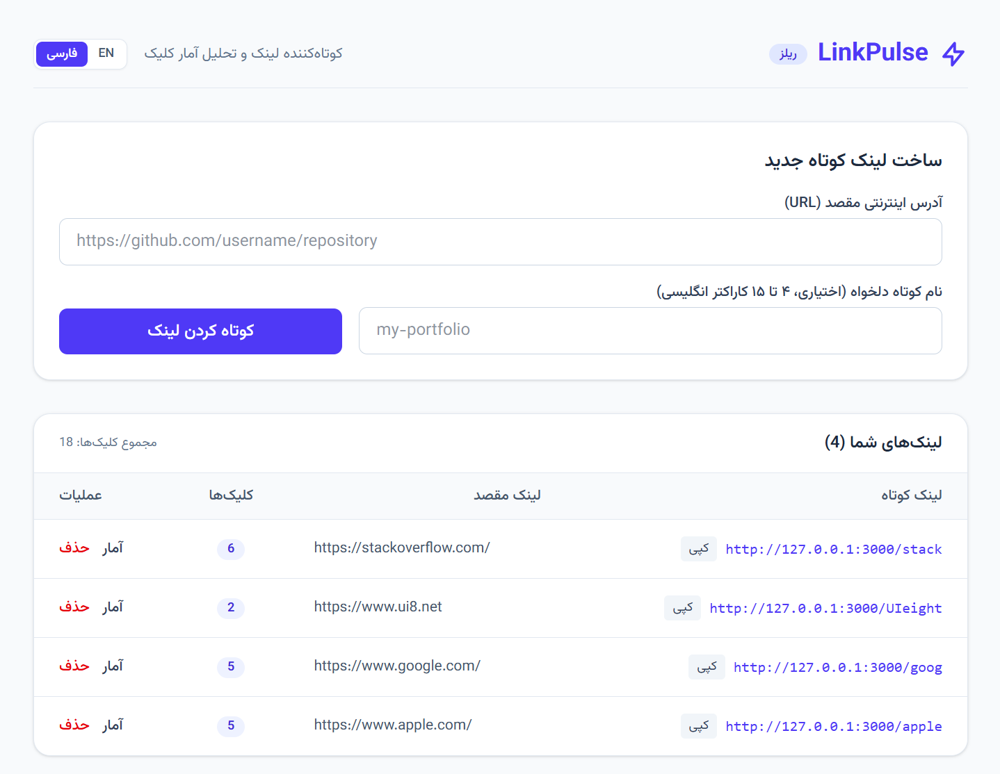
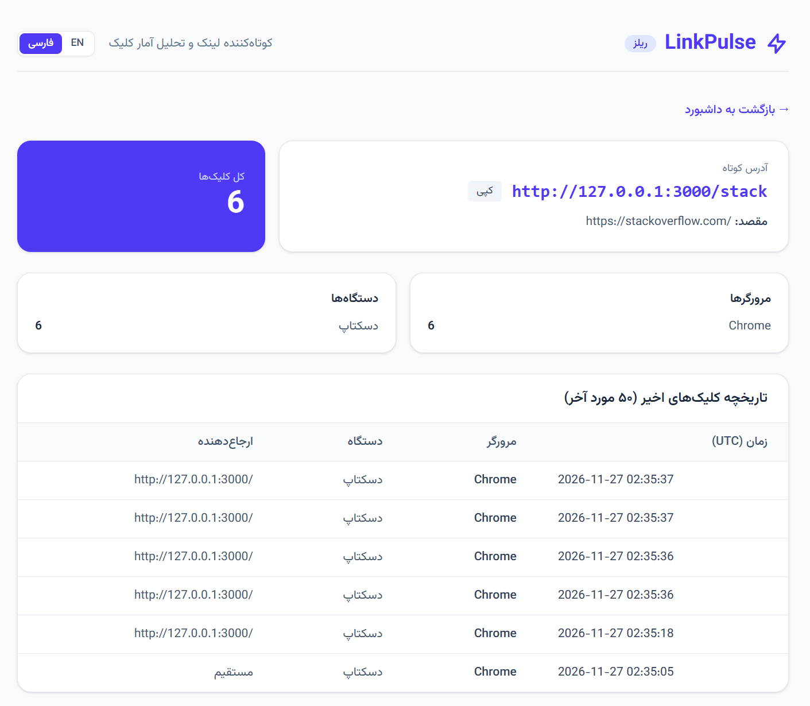

# LinkPulse

A full-stack URL shortener and real-time click analytics web application built with **Ruby on Rails 8** and **Tailwind CSS**, featuring a bilingual **English / Persian (RTL/LTR)** interface and a **RESTful JSON API**.

## Features

- **Smart URL Shortening:** Automatically generates collision-free 6-character Base62 short codes or accepts validated custom aliases.
- **Click Analytics Dashboard:** Tracks every redirect (`302 Found`) and aggregates browser types, device categories (Desktop/Mobile/Tablet), referers, and timestamps.
- **Bilingual UI (English & Persian):** Instant language switching powered by Rails I18n with automatic RTL/LTR layout adaptation and Vazirmatn typography.
- **RESTful JSON API:** Full CRUD and analytics endpoints under `/api/v1/links`.
- **Automated Testing & CI:** Model and integration tests covering redirects, validations, I18n switching, and API responses, automated with GitHub Actions and RuboCop.

## Screenshots

### Dashboard (Bilingual EN / FA)

### Click Analytics

## Tech Stack

- **Backend:** Ruby 3.3, Ruby on Rails 8
- **Frontend:** ERB, Tailwind CSS, Hotwire / Turbo
- **Database:** SQLite3
- **Testing & Linting:** Minitest, RuboCop Rails Omakase, GitHub Actions

## Local Setup

~~~bash
git clone https://github.com/YOUR_GITHUB_USERNAME/linkpulse.git
cd linkpulse
bundle install
bin/rails db:prepare
bin/rails tailwindcss:build
bin/rails server
~~~

Open `http://localhost:3000` in your browser.

## Running Tests

~~~bash
bin/rails test
bin/rubocop
~~~

## REST API Example

**Create a short link:**
~~~bash
curl -X POST http://localhost:3000/api/v1/links \
  -H "Content-Type: application/json" \
  -d '{"link":{"original_url":"https://rubyonrails.org","short_code":"rails"}}'
~~~

**Fetch link statistics:**
~~~bash
curl http://localhost:3000/api/v1/links/rails
~~~

## License

MIT
